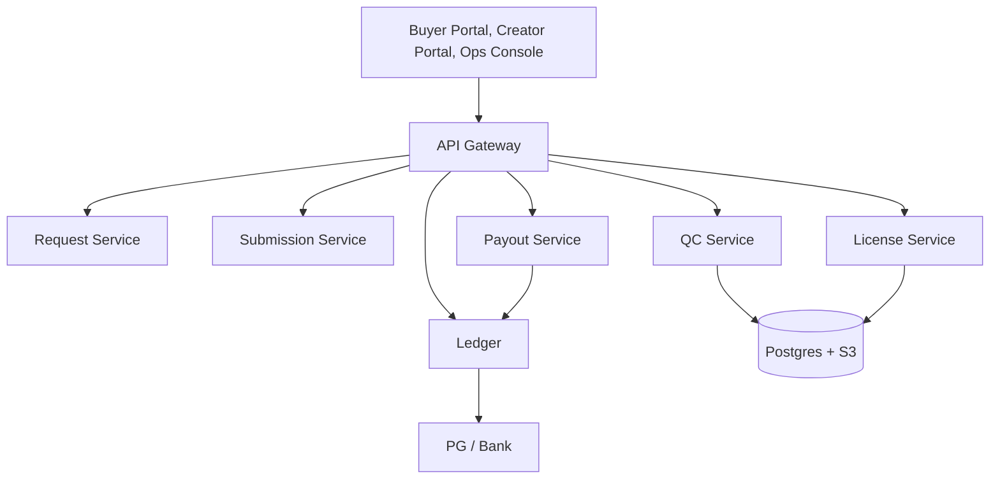

# Architecture

**Scope** Demand-pulled data licensing for vertical AI. First domain: Korean voice / K-beauty / expert annotations. Global by design; domain-config driven.

---

## 1. Principles

1. **Demand first.** A submission is always tied to a paid request.
2. **Rights first.** Consent, provenance, and license are first-class data.
3. **QC is the product.** Quality score and human review decide acceptance.
4. **No token.** Fiat/KRW payouts; a double-entry ledger.
5. **Creator ownership.** License, not assignment.

---

## 2. Components



| Component | Responsibility |
|---|---|
| Request | domain, spec, quantity, quality bar, rights, budget, deadline |
| Submission | creator, file metadata, consent, status |
| Asset / catalog | self-upload, data type, price, license scope, status |
| QC | quality score, duplicate check, PII/illegal-content scan, human review |
| License | dataset assembly, license terms, provenance bundle |
| Payout | creator share, tax withholding, ledger |
| Ledger | client funds, creator payable, platform revenue |

---

## 3. Data model

| Entity | Key fields |
|---|---|
| `buyer` | id, name, domain, kyc_status |
| `creator` | id, name, domain, kyc_status, payout_account |
| `request` | id, buyer_id, title, domain, spec, quantity, unit_price, rights, deadline, status |
| `submission` | id, request_id, creator_id, file_key, sha256, note, qc_score, status |
| `consent` | id, submission_id, subject, purpose, scope, expires_at |
| `license` | id, request_id, buyer_id, terms, fee, status |
| `asset` | id, creator_id, data_type, title, domain, file_key, qc_score, price, status, licensed_by |
| `asset_license` | id, asset_id, buyer_id, terms, fee, status |
| `payout` | id, creator_id, license_id, gross, share, tax, net, status |
| `ledger_entry` | id, source_type, source_id, created_at |
| `posting` | id, entry_id, account, debit, credit, currency |
| `case` | id, type, subject_id, assignee, status |

**Invariants**
- A submission cannot be `ACCEPTED` without a `consent` record and QC pass.
- An `asset` cannot be `LISTED` without a consent record and QC pass.
- An asset license cannot be issued unless the asset is `LISTED`.
- A license cannot be issued without at least one accepted submission.
- A payout cannot exceed net license revenue.
- Every journal entry balances.

---

## 4. API

| Method | Path | Description |
|---|---|---|
| POST | `/api/requests` | create a data request |
| GET | `/api/requests` | list open requests |
| GET | `/api/requests/{id}` | request detail + submissions |
| POST | `/api/requests/{id}/submissions` | creator submits data |
| POST | `/api/submissions/{id}/accept` | platform accepts |
| POST | `/api/submissions/{id}/reject` | platform rejects |
| POST | `/api/requests/{id}/license` | buyer licenses dataset; payouts |
| POST | `/api/assets` | creator uploads a self-serve asset |
| GET | `/api/assets` | open catalog (filter by type/domain) |
| GET | `/api/assets/{id}` | asset detail |
| POST | `/api/assets/{id}/license` | buyer licenses asset; payout |
| GET | `/api/ledger` | ledger summary |
| GET | `/api/stats` | GMV, payouts, take |

### Upload asset (open catalog)

```json
{
  "creator": "Mina K.",
  "title": "Korean skincare photo set",
  "data_type": "image",
  "domain": "beauty",
  "description": "front-facing, natural light, consent attached",
  "file_name": "mina_set_01.jpg",
  "price_krw": 500
}
```

`data_type` is one of `image`, `text`, `audio`, `video`, `annotations`, `document`.

### Create request

```json
{
  "buyer": "K-Beauty AI",
  "title": "Korean skincare reviews + photos",
  "domain": "beauty",
  "spec": "1,000 reviews with a face photo, natural light, 1080px+",
  "quantity": 1000,
  "unit_price_krw": 500,
  "rights": "AI training, 2 years, global, no resale",
  "deadline": "2026-12-01"
}
```

### Submit

```json
{
  "creator": "Mina K.",
  "file_name": "mina_001.jpg",
  "note": "front-facing, natural light, consent attached"
}
```

---

## 5. QC pipeline

```
upload → hash → duplicate check → PII/illegal scan → quality score → human review → accept/reject
```

| Check | Rule | Action |
|---|---|---|
| Duplicate | sha256 or perceptual hash | reject |
| PII | face/name/contact detection | require consent or anonymize |
| Illegal | CSAM/violence/stolen content | block and report |
| Quality | resolution, blur, framing | score <0.7 reject |
| Rights | consent record present | missing → reject |
| Human | edge cases, sensitive data | manual review |

---

## 6. License and payout

1. Buyer reviews a sample; accepts the dataset.
2. Deed issues a license with scope, term, territory, fee.
3. Buyer pays into a segregated client account.
4. Ledger: Dr client cash; Cr creator payable + platform revenue.
5. Payout: creator share (50–70%) minus tax; platform keeps 30–40%.
6. Creator receives KRW/fiat; receipt and tax documents issued.

**Example (request):** 1,000 units × ₩500 = ₩500,000. Creator 60% = ₩300,000; platform 40% = ₩200,000; QC/payment cost ₩45,000; contribution ₩155,000.

**Example (open catalog):** one image asset at ₩500. Creator 60% = ₩300; platform 40% = ₩200. Listing is free; payment happens only when a buyer licenses it.

---

## 7. Security and compliance

- KYC for buyers and creators.
- Consent and provenance records, immutable audit log.
- Encryption at rest and in transit; signed URLs for files.
- PII minimization; deletion workflow.
- Access control: buyer sees only licensed data; creator sees own submissions.
- Incident response and takedown process.
- Data residency: Korea for Korean personal data; US/EU options for global buyers.

---

## 8. Roadmap

| Phase | Scope |
|---|---|
| 0 | manual requests, manual QC, spreadsheet payouts |
| 1 | self-serve request/submission, AI QC, ledger |
| 2 | license automation, enterprise contracts, second domain |
| 3 | API, multi-domain, global creators |

---

**KR 요약** — 요청·제출·검수·라이선스·정산이 하나의 원장으로 연결된다. 검수는 중복·PII·불법 콘텐츠·품질·권리 확인으로 구성되고, 라이선스 후 크리에이터에게 매출의 50~70%를 지급한다.
