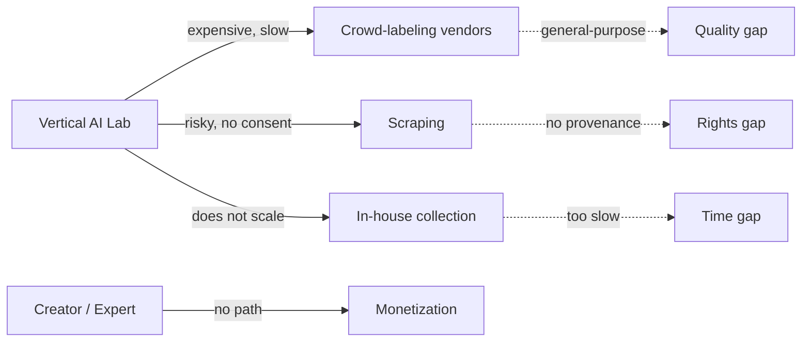
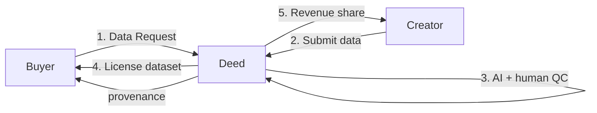
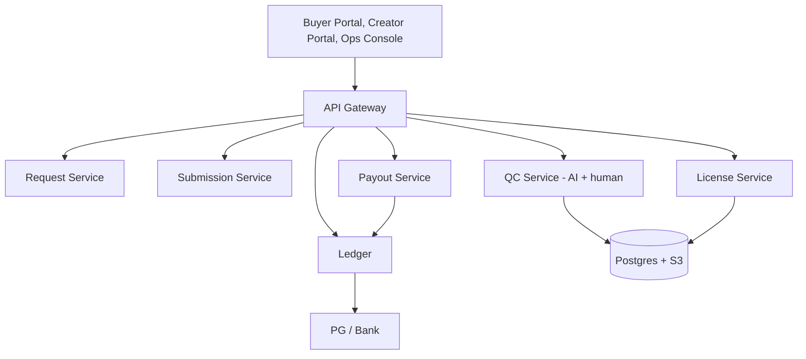

# Deed — Blueprint

**One-page thesis** Deed is the licensed data supply layer for vertical AI. Buyers post a data request, creators submit rights-cleared data, and get paid when it is licensed. Demand comes first; quality and rights are the product.

---

## 1. The problem in one picture

Vertical AI labs need **domain-specific, rights-cleared, verifiable data**. Creators have it but cannot license it. Generic marketplaces fail because supply is random, rights are unclear, and demand is specific.

---

## 2. The solution in one picture

**Demand-pulled, not upload-first.** Every submission is against a real request with a budget, a spec, and a buyer.

---

## 3. The flow

| Step | Buyer | Deed | Creator |
|---|---|---|---|
| 1 | Posts request: domain, spec, quantity, quality, rights, budget, deadline | Anonymizes, publishes | — |
| 2 | — | — | Submits data against request |
| 3 | — | AI QC: quality, duplicate, PII, rights; human review | Gets feedback / acceptance |
| 4 | Reviews sample, licenses dataset | Assembles dataset, license, provenance | — |
| 5 | Pays license fee | Takes 30–40%, pays creator 50–70% | Receives KRW/fiat payout |

---

## 4. What makes it different

| Generic data marketplace | Deed |
|---|---|
| Upload anything, hope it sells | Buyer request with a budget |
| Unclear rights | License, consent, provenance, deletion |
| Low-quality dump | AI + human QC; acceptance rate is a metric |
| Users trade data with each other | No user-to-user trading; B2B license only |
| Token/price speculation | No token; fiat/KRW payout |
| General data | Vertical: Korean voice, K-beauty, expert annotations |

---

## 5. System blueprint

| Component | Responsibility |
|---|---|
| Request | spec, budget, rights, deadline, buyer |
| Submission | file metadata, consent, creator, status |
| QC | quality score, duplicate/PII check, human review |
| License | dataset assembly, license terms, provenance |
| Payout | revenue share, tax withholding, ledger |
| Ledger | double-entry: client funds, creator payable, platform revenue |

---

## 6. Data and rights blueprint

**License, not assignment.**

- Creator grants Deed a non-exclusive right to sublicense the data for AI training/evaluation.
- Buyer gets a defined scope: purpose, term, territory, no resale, no re-identification.
- Creator retains ownership; can withdraw future use; deletion handled per contract.
- Consent covers PIPA/GDPR: purpose, third-party provision, cross-border transfer, retention.
- Prohibited: illegal content, CSAM, non-consensual intimate data, stolen data, sensitive data without explicit consent.

Full terms: [LEGAL.md](LEGAL.md).

---

## 7. Unit economics

| Item | Example |
|---|---|
| Request | 1,000 K-beauty photos |
| Buyer price | ₩500/image → ₩500,000 |
| Creator share | 60% → ₩300,000 |
| Platform | 40% → ₩200,000 |
| QC/payment cost | ₩45,000 |
| Platform contribution | ₩155,000 |
| Sell-through | ~100% (request-backed) |

**Request-backed supply makes sell-through predictable.** The platform does not carry random inventory.

---

## 8. Twelve-month plan

| Phase | Timeline | Scope | Target |
|---|---|---|---|
| 0 | 0–3M | one domain, 3 buyers, 100 creators, manual QC | 1,000 data units, first revenue |
| 1 | 3–9M | self-serve requests, QC automation, payouts | 10 buyers, 500 creators, $100k GMV |
| 2 | 9–18M | second domain (voice), enterprise contracts | $500k GMV, 30% take |
| 3 | 18–30M | API, multi-domain, global creators | $2M GMV, 100+ buyers |

---

## 9. YC scorecard

| Criterion | Deed |
|---|---|
| 10x | 2–5x faster/cheaper than vendors; legal provenance |
| Market | AI data infrastructure; vertical data is scarce |
| Revenue | 30–40% take on data licensing; no token |
| Moat | creator network + rights/provenance + QC + buyer contracts |
| Why now | vertical models, data exhaustion, privacy regulation, creator monetization |
| Global | any language/domain; Korea/Asia first |
| Risk | low data prices, multi-homing, buyer concentration |

---

## 10. What YC should remember

1. **Demand-pulled.** Every dataset starts with a buyer request and a budget.
2. **Rights and QC are the product.** Not another data dump.
3. **Creators get paid.** 50–70% revenue share, in KRW/fiat, no token.

---

**KR 요약** — Deed는 버티컬 AI 기업의 데이터 요청을 크리에이터가 채우고, 검수·라이선스 후 원화로 수익을 나누는 B2B 데이터 라이선싱 마켓이다. 요청 기반이라 sell-through가 예측 가능하고, 권리·검수가 해자다.
